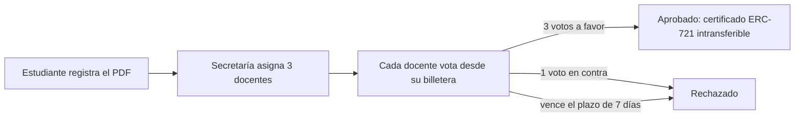
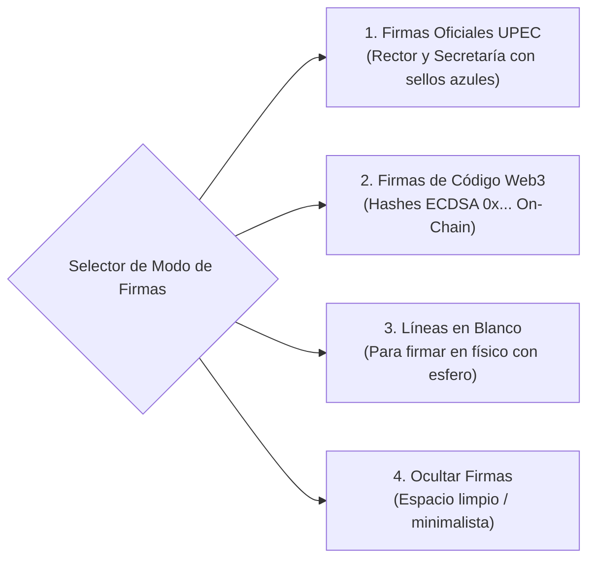

# Manual de usuario del prototipo Web3 de titulación UPEC

Universidad Politécnica Estatal del Carchi · Facultad de Industrias Agropecuarias y Ciencias Ambientales · Carrera de Computación

Prototipo académico sin validez legal. Los nombres y cédulas que aparecen en la demostración son ficticios.

---

## 1. Puesta en marcha

### Opción A: `iniciar_todo.bat`

Hace doble clic en `iniciar_todo.bat`. El script abre el nodo Hardhat (puerto 8545), despliega los tres contratos, carga tres proyectos de demostración, abre el proxy IPFS (puerto 8787) y levanta la interfaz en http://localhost:3000.

### Opción B: paso a paso

```powershell
npm install
npm --prefix client install
npx hardhat node --hostname 127.0.0.1          # terminal 1
npm run deploy:local                           # terminal 2
npm run preparar                               # proyectos de demostración
npm run ipfs-proxy                             # terminal 3 (necesita PINATA_JWT en .env)
npm run dev                                    # terminal 4
```

`npm run preparar` deja tres casos en la cadena: un proyecto aprobado por los tres docentes con su certificado #1, uno con tribunal asignado y un voto, y uno que todavía espera tribunal.

### Firebase

1. Crear un proyecto en Firebase, activar Authentication (correo y contraseña) y Firestore.
2. Copiar `client/.env.example` como `client/.env` y llenar las cuatro variables `VITE_FIREBASE_*`.
3. Publicar las reglas: `npx firebase-tools deploy --only firestore`.
4. Crear las cuentas de Secretaría y de los docentes: descargar la clave de cuenta de servicio, poner su ruta en `GOOGLE_APPLICATION_CREDENTIALS` y ejecutar `npm run seed:firebase`.

Sin las variables de Firebase la aplicación arranca en modo local: los datos quedan en el navegador y las cuentas de demostración usan la contraseña `demo2026`.

### Pruebas y análisis

```powershell
npm test                 # 69 pruebas
npm run coverage         # cobertura
slither .                # análisis estático (requiere Python y slither-analyzer)
```

Las salidas usadas en la tesis están en `docs/evidencias/`.

---

## 2. Dónde vive cada dato

| Dato | Dónde se guarda | Quién lo cambia |
| :--- | :--- | :--- |
| Título, CID de IPFS, hash SHA-256 del PDF, autor | Contrato `ProjectRegistry` | El autor, solo antes del primer voto |
| Tribunal, votos, estado, certificado | Contrato `ProjectRegistry` | Secretaría asigna; cada docente vota una vez |
| PDF de la tesis | IPFS (Pinata), a través del proxy | Nadie, el CID identifica el contenido |
| Nombre, cédula, carrera, calificación | Firestore (`projects/{hash del PDF}`) | El autor o Secretaría; se puede borrar (LOPDP) |
| Perfiles y roles de la interfaz | Firebase Auth + Firestore (`users/{uid}`) | Secretaría |

La cadena es la fuente de verdad del estado. Firestore no puede aprobar ni rechazar nada.

---

## 3. Roles y flujo



### Estudiante
- Se registra con su correo; la cuenta nace siempre con rol de estudiante.
- Conecta MetaMask, adjunta el PDF y registra el proyecto. La app calcula el hash SHA-256 del archivo, lo sube a IPFS y envía la transacción. Si el mismo PDF ya estaba registrado, el contrato lo rechaza.
- Puede corregir título y resumen mientras nadie haya votado.

### Secretaría
- Su billetera tiene el rol de administrador en el contrato.
- En "Tribunal DAO" elige a los tres docentes de cada proyecto. Los tres deben tener el rol de docente en el contrato, ser distintos y no ser el autor. Desde ese momento corre el plazo de 7 días.

### Docente
- Solo ve los botones de voto en los proyectos de los que forma parte.
- Vota una vez. Un voto en contra rechaza el proyecto; el tercer voto a favor emite el certificado.
- Si vence el plazo sin los tres votos a favor, cualquier usuario puede cerrar el proyecto como rechazado.

### Certificado
- Es un token ERC-721 que no se puede transferir ni aprobar a terceros (soulbound).
- Lleva un código QR que abre `/?verify=<número de proyecto>` sin necesidad de iniciar sesión.

---

## 4. Módulo del Título Oficial de Grado (Diploma UPEC)

Este módulo reproduce con fidelidad milimétrica el Título Oficial de Grado emitido por la Universidad Politécnica Estatal del Carchi.

### A. Elementos Gráficos e Institucionales Incluidos
- **Marco de Portadiplomas:** Fondo de cuero azul marino (`#0c192e`) con sus cuatro esquinas blancas de sujeción tradicional.
- **Heráldica Oficial:** Escudo de Armas de la República del Ecuador en la parte superior central y Logotipo circular UPEC en la parte superior izquierda.
- **Franjas Institucionales:** Dos líneas verticales verdes continuas (`#006B38`) en el margen izquierdo.
- **Medallón Notarial Dorado:** Troquelado en 32 puntas con relieve UPEC y cinta tricolor ondulada en la base izquierda.
- **Sellos Húmedos Azul Institucional:** Sellos circulares oficiales de Rectorado y Secretaría General con texto perimetral.
- **Marca de Agua Guilloché:** Patrón concéntrico de seguridad con el Búho UPEC al centro con opacidad sutil.

### B. Personalización y Edición en Vivo

Justo encima del diploma se encuentra la **Barra de Edición en Vivo** (que no aparece al imprimir), donde puedes modificar en tiempo real:

1. **Nombre Completo del Graduando:** Se formatea en mayúsculas romanas y color rojo borgoña oficial (`#991B1B`).
2. **Cédula de Identidad (C.C):** Número de cédula del profesional.
3. **Título Conferido:** Escribe la ingeniería o título (ej. *Ingeniero en Computación*, *Ingeniera Agropecuaria*, *Ingeniero de Software*). Se renderiza automáticamente en **caligrafía gótica Fraktur histórica**.
4. **Carrera Universitaria y Facultad:** Modificables libremente.
5. **Lugar, Fecha y Año:** Puedes ajustar el año o la fecha completa (ej. *Tulcán, 24 de noviembre de 2026* o *Tulcán, 2026*).

---

## 5. Control de Firmas: ¿Tienen que ser el código o firmas de personas?

El sistema incluye un selector de 4 botones para alternar el comportamiento de las firmas según la necesidad:



### Explicación Legal vs. Tecnológica:
- **En el Título Físico Impreso (Ley LOES de Ecuador):** Las firmas **SÍ tienen que ser las de las personas** (Rector y Secretaría General) con sus sellos oficiales. Un documento de papel sin firmas de autoridades carece de validez legal ante SENESCYT.
- **En la Tecnología Web3 (Blockchain):** La verdadera firma de seguridad **SÍ es el código**. Es una **firma criptográfica digital ECDSA** emitida por las llaves privadas de las wallets de los docentes, inmutable e infalsificable.
- **Cómo usar los modos en tu presentación de Tesis:**
  - Elige **"Firmas y Sellos Oficiales"** si deseas mostrar el diploma idéntico al documento físico real de la UPEC.
  - Elige **"Firmas de Código Web3"** para demostrar a los docentes cómo los hashes criptográficos `0x...` reemplazan matemáticamente a la tinta.
  - Elige **"Líneas para Firma Física"** si vas a imprimir el diploma en papel pergamino para que las autoridades lo firmen físicamente con pluma.
  - Elige **"Ocultar Firmas"** si prefieres un diseño centrado exclusivamente en el código QR y hash IPFS.

---

## 6. Exportación e Impresión a PDF Oficial (300 DPI)

Para generar el PDF oficial del diploma:

1. Haz clic en el botón superior **"Imprimir / Exportar PDF"** (o presiona `Ctrl + P`).
2. En la ventana de impresión del navegador:
   - **Destino:** Guardar como PDF (o selecciona tu impresora).
   - **Diseño:** Vertical (Portrait).
   - **Tamaño de Papel:** A4.
   - **Gráficos de fondo:** Asegúrate de marcar la casilla **"Gráficos de fondo"** (*Background graphics*) para que se impriman el sello dorado, las franjas verdes y los sellos azules.
3. El sistema aplicará las reglas CSS `@media print` automáticamente:
   - Oculta el marco exterior azul, la barra lateral y los controles de edición.
   - Quita los bordes de los campos de texto.
   - Imprime el lienzo pergamino a tamaño A4 exacto con vectores nítidos a 300 DPI.

---

## 7. Verificación pública

Cualquier persona puede comprobar un título de tres maneras, en la pestaña "Verificación de certificados" o desde el enlace del QR:

1. Escribir el número del proyecto o del certificado.
2. Subir el PDF de la tesis. La app calcula su SHA-256 y consulta `verifyDocument` en el contrato. Si el archivo cambió en un solo byte, el hash no coincide y aparece como no registrado.
3. Escanear el código QR del certificado con la cámara (en el APK de Android también funciona).

El resultado muestra el estado según la cadena, los votos del tribunal, el hash registrado y el CID de IPFS. Nombre y carrera aparecen solo si existen en Firestore.

---

## 8. Preguntas Frecuentes y Solución de Problemas

### 1. ¿Cómo restablecer todos los datos si hice cambios que quiero deshacer?
En la barra de edición superior, haz clic en el botón **"Restablecer"** con el ícono circular. Esto restaurará de inmediato los valores predeterminados.

### 2. ¿Qué hacer si al iniciar el sistema indica que el puerto 3000 o 8545 está ocupado?
Abre PowerShell y ejecuta:
```powershell
Stop-Process -Name node -Force
```
Luego vuelve a ejecutar `iniciar_todo.bat`.

### 3. ¿Los datos editados en la barra se guardan al recargar?
Los cambios de presentación del diploma se guardan en el navegador. Los datos personales del graduando se guardan en Firestore desde "Editar datos". Lo que está en la cadena (votos, estado, hash) no se edita desde ninguna pantalla.

### 4. MetaMask muestra un error de nonce
Pasa cuando se reinicia el nodo Hardhat. En MetaMask: Configuración > Avanzado > Borrar datos de actividad.

### 5. El PDF se registró en "modo demostración"
El proxy IPFS no estaba corriendo o falta `PINATA_JWT`. El hash SHA-256 sí quedó en la cadena, pero el archivo solo está en ese navegador.
